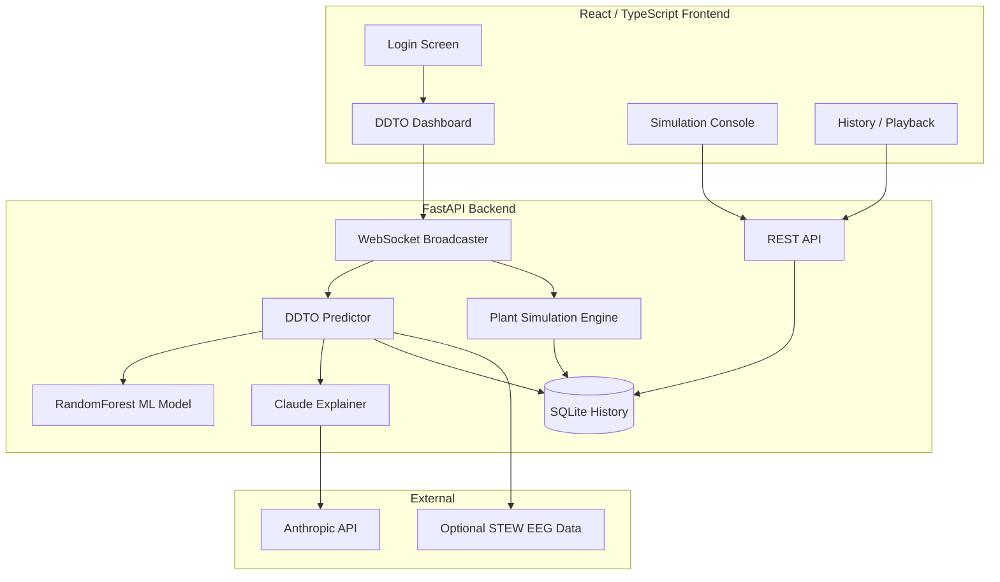
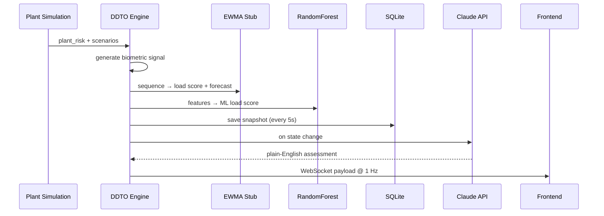
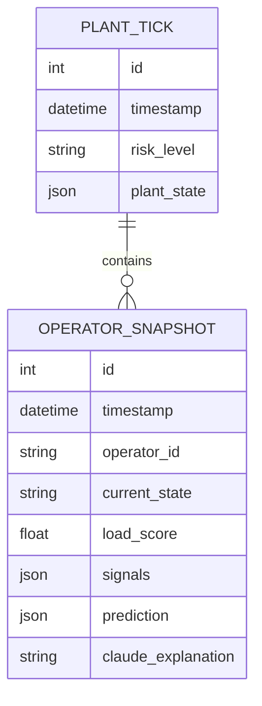
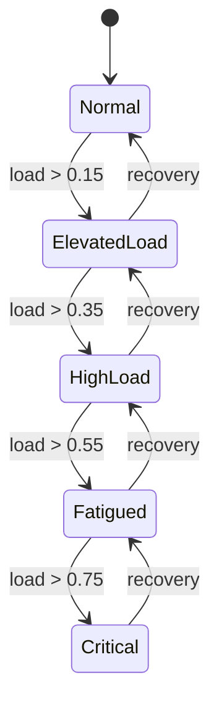

# NewTron Architecture

## High-Level System Diagram



## Prediction Pipeline



## Data Model (simplified)



## Cognitive State Machine



## New Capabilities (Bulk-up)

| Feature | Implementation | Value |
|---------|----------------|-------|
| Persistence | SQLite + SQLAlchemy | History, playback, audit |
| ML Model | scikit-learn RandomForest | Real model path + metrics |
| History API | `/ddto/history`, `/ddto/plant-history` | Frontend charts & scrubber |
| Tests | pytest core suite | Quality signal |
| Docker | docker-compose.yml | One-command demo |
| Diagrams | Mermaid in this file | Recruiter-friendly docs |

## Run with Docker

```bash
# From repo root (set ANTHROPIC_API_KEY if desired)
docker-compose up --build
```

- Frontend: http://localhost:5173  
- Backend docs: http://localhost:8000/docs  
- History endpoints available immediately after a few ticks
