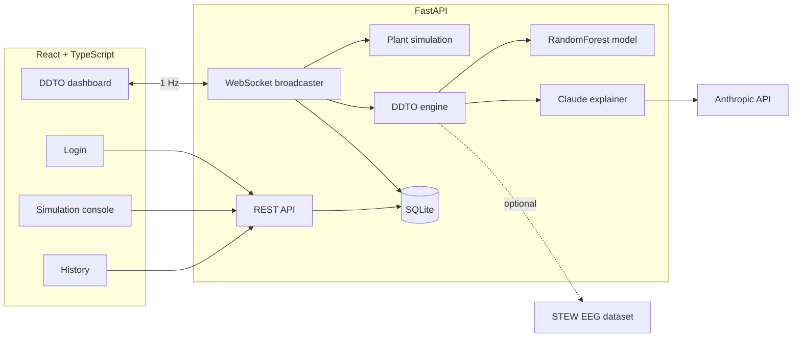

# NewTron

**A dynamic digital twin of the nuclear plant operator.** NewTron models each control-room operator against their own cognitive baseline, forecasts their cognitive state up to 15 minutes ahead, and explains the forecast in plain English, so a supervisor can act before an error happens rather than after.

Built for the CITECH (Cognitive Innovative Technology) competition at Ontario Tech University.


---

## Contents

- [Why it exists](#why-it-exists)
- [Features](#features)
- [Architecture](#architecture)
- [Getting started](#getting-started)
- [Using the demo](#using-the-demo)
- [API reference](#api-reference)
- [How the prediction works](#how-the-prediction-works)
- [Testing](#testing)
- [Project structure](#project-structure)
- [Limitations](#limitations)
- [Acknowledgements](#acknowledgements)

---

## Why it exists

Control-room monitoring systems watch the plant closely and the operator barely at all. Those that do monitor the operator compare them against population-wide thresholds and report only the present moment.

NewTron takes a different position on three points:

| Conventional monitoring | NewTron |
|---|---|
| Watches the plant | Watches the operator, with the plant as context |
| Population thresholds | A personal baseline per operator |
| Reports current state | Forecasts state 5, 10 and 15 minutes ahead |
| One operator at a time | A crew-level index that captures compounding risk |

## Features

- **Per-operator digital twin.** Three operators are modelled simultaneously, each with their own experience level, fatigue rate and automation-bias tendency. Every reading is scored as a deviation from that operator's own normal.
- **15-minute cognitive forecast.** A sequence predictor projects load at 5, 10 and 15 minutes with a trend and a confidence value, mapped onto five states from `normal` to `critical`.
- **Machine-learning model path.** A scikit-learn `RandomForestRegressor` scores the same signals alongside the sequence predictor and reports its own metrics.
- **Crew Cognitive State Index (CCSI).** A single 0 to 100 score for the whole crew, with a compound penalty when two or more operators degrade at the same time.
- **Plain-English assessments.** Anthropic Claude turns each operator's signals and forecast into a short assessment. A deterministic fallback is used when no API key is set.
- **Simulated plant.** A reactor cooling subsystem with a causal graph, fault scenarios and manual overrides. Plant risk feeds directly into operator load.
- **Persistence and history.** Plant ticks and operator snapshots are written to SQLite every five seconds and served through history endpoints and a History page.
- **Optional real EEG data.** When the STEW dataset is present, real EEG band powers replace the synthetic ones and the dashboard labels the data source accordingly.

## Architecture



Once per second the backend advances the plant simulation, runs every operator twin, computes the crew index and broadcasts one combined payload to all connected clients. Sequence diagrams, the data model and the state machine are in [ARCHITECTURE.md](./ARCHITECTURE.md). Operator profiles and signal definitions are in [CONTEXT.md](./CONTEXT.md).

| Layer | Technology |
|---|---|
| Backend | Python, FastAPI, WebSockets, SQLAlchemy |
| Modelling | scikit-learn, NumPy |
| Explanations | Anthropic Claude via the Messages API |
| Frontend | React 18, TypeScript, Vite, Recharts |
| Storage | SQLite |
| Tooling | Docker Compose, pytest |

## Getting started

### Prerequisites

- Python 3.10 or newer
- Node.js 18 or newer
- An Anthropic API key (optional; enables Claude-written assessments)

### Option 1: Docker

```bash
docker compose up --build
```

To enable Claude assessments, export `ANTHROPIC_API_KEY` in your shell before running the command.

### Option 2: Run locally

**Backend**, on port 8000:

```bash
cd backend
python -m venv venv
source venv/bin/activate        # Windows: venv\Scripts\activate
pip install -r requirements.txt
uvicorn app.main:app --reload --port 8000
```

**Frontend**, on port 5173, in a second terminal:

```bash
cd frontend
npm install
npm run dev
```

The Vite dev server proxies API calls to the backend.

### Configuration

| Variable | Where | Purpose |
|---|---|---|
| `ANTHROPIC_API_KEY` | `backend/.env` or shell | Enables Claude assessments. Without it, a built-in fallback is used. |
| `VITE_PROXY_TARGET` | Frontend environment | Backend origin for the dev proxy. Defaults to `http://localhost:8000`. |

`backend/.env` is git-ignored. Do not commit API keys.

## Using the demo

1. Open the frontend on port 5173 and sign in as one of the demo operators.

   | Operator | Role | Username | Password |
   |---|---|---|---|
   | Alex Chen | Senior Reactor Operator | `alex.chen` | `citech2026` |
   | Blair Santos | Reactor Operator | `blair.santos` | `citech2026` |
   | Casey Morgan | Senior Reactor Operator | `casey.morgan` | `citech2026` |

   These are fixed demonstration accounts, not a real authentication system.

2. **Press Resume.** The simulation starts paused.
3. Trigger an operator scenario from the dashboard header: *Fatigue Onset*, *Workload Spike* or *Automation Bias*. Watch the forecast, biometric tiles and crew index respond.
4. Open the **Sim Console** to start a plant fault (`pump_degradation` or `flow_restriction`), override a plant variable or reset the simulation.
5. Open **History** after a minute or so to see persisted cognitive load over time.

| Route | Page |
|---|---|
| `/` | DDTO dashboard for the signed-in operator |
| `/console` | Simulation console |
| `/history` | Historical cognitive load |

## API reference

Interactive documentation is served by the backend at `/docs`.

**Live stream**

| Endpoint | Description |
|---|---|
| `WS /ws` | Combined plant, operator and crew payload, about once per second |

**Operator twin** (`/ddto`)

| Method | Endpoint | Description |
|---|---|---|
| `POST` | `/ddto/login` | Authenticate a demo operator |
| `GET` | `/ddto/operators` | List operators and their current state |
| `GET` | `/ddto/operator/{operator_id}` | Full snapshot for one operator |
| `POST` | `/ddto/scenario` | Set or clear an operator scenario |
| `POST` | `/ddto/reset` | Reset all operator twins |
| `GET` | `/ddto/explain/{operator_id}` | Generate an assessment on demand |
| `GET` | `/ddto/ccsi` | Current Crew Cognitive State Index |
| `GET` | `/ddto/data-source` | Whether signals are synthetic or real EEG |
| `GET` | `/ddto/history` | Persisted operator snapshots, newest first. Query: `operator_id`, `limit` |
| `GET` | `/ddto/plant-history` | Persisted plant ticks, newest first. Query: `limit` |
| `GET` | `/ddto/ml-metrics` | RandomForest model metrics |

**Plant simulation** (`/simulate`)

| Method | Endpoint | Description |
|---|---|---|
| `GET` | `/simulate/state` | Current plant state |
| `GET` | `/simulate/status` | Whether the simulation is paused |
| `POST` | `/simulate/pause`, `/simulate/resume` | Pause or resume the tick loop |
| `GET` | `/simulate/scenarios` | Available plant scenarios |
| `POST` | `/simulate/scenario/start/{name}`, `/simulate/scenario/stop/{name}` | Start or stop a scenario |
| `POST` | `/simulate/override` | Set a plant variable directly |
| `POST` | `/simulate/reset` | Reset the plant |

**Other**

| Method | Endpoint | Description |
|---|---|---|
| `POST` | `/operator/event` | Record an operator interaction |
| `GET` | `/operator/events` | Recent operator interactions |
| `POST` | `/operator/reset` | Clear the interaction log |
| `POST` | `/ai/interpret` | Interpret a free-text prompt |

The full WebSocket payload is typed in [`frontend/src/services/websocket.ts`](frontend/src/services/websocket.ts).

## How the prediction works

**Signals.** Each tick produces a reading per operator across three groups:

| Group | Signals |
|---|---|
| EEG band powers | theta, alpha, beta, theta/alpha ratio, beta/alpha ratio, engagement index |
| Eye tracking | blink rate, PERCLOS, pupil dilation |
| Performance | response latency, estimated error probability |

**Load score and state.** Signals are compared with the operator's personal baseline to give a load score between 0 and 1, which maps to a state:

| State | Load score | Meaning |
|---|---|---|
| `normal` | below 0.15 | Within personal baseline |
| `elevated_load` | 0.15 to 0.35 | Above baseline; monitor |
| `high_load` | 0.35 to 0.55 | Significantly elevated; advisory |
| `fatigued` | 0.55 to 0.75 | Clear fatigue markers; intervene |
| `critical` | above 0.75 | Immediate supervisor action |

**Forecast.** The sequence predictor applies exponential smoothing and trend extrapolation to the recent load history to project 5, 10 and 15 minutes ahead. The RandomForest model scores the current reading independently from 13 engineered features, and its result is included in each snapshot for comparison.

**Crew index.** The CCSI starts from a weighted average of individual load and subtracts a compound penalty when two or more operators are degraded at once, reflecting that crew risk compounds rather than adds.

**Explanation.** When an operator leaves the `normal` state, their signals, forecast and plant context are sent to Claude, which returns a short assessment for the supervisor.

### Using real EEG data

NewTron runs on synthetic signals by default. To use real EEG recordings, download the [STEW dataset](https://figshare.com/articles/dataset/STEW_Dataset_Raw_EEG_Data/6198183) and place the CSV files (`sub01_lo.csv`, `sub01_hi.csv`, and so on) in `backend/data/STEW/`. The backend detects them at startup, extracts band powers and caches the result. Eye-tracking and performance signals remain synthetic.

## Testing

```bash
cd backend
pytest
```

The suite covers state thresholds, the forecast contract, plant state serialisation, the simulation tick and the RandomForest model.

## Project structure

```
newtron/
├── backend/
│   ├── app/
│   │   ├── main.py            FastAPI entry point
│   │   ├── websocket.py       1 Hz broadcast loop
│   │   ├── persistence.py     SQLite models and history queries
│   │   ├── ddto/              Profiles, signals, predictors, crew index, explainer
│   │   ├── simulation/        Plant state, tick engine, fault scenarios
│   │   ├── causal/            Causal graph and root-cause reasoning
│   │   ├── operator/          Operator interaction tracking
│   │   ├── teaming/           Authority modes and recommendations
│   │   └── api/routes/        REST endpoints
│   ├── tests/
│   ├── Dockerfile
│   └── requirements.txt
├── frontend/
│   ├── src/
│   │   ├── pages/             Login, dashboard, console, history
│   │   ├── components/        Forecast, crew index, signal and sensor panels
│   │   ├── hooks/             Smoothing and biometric history
│   │   └── services/          REST and WebSocket clients
│   └── Dockerfile
├── docker-compose.yml
├── ARCHITECTURE.md
└── CONTEXT.md
```

## Limitations

NewTron is a research prototype and a competition demo. It is not a safety system.

- **Signals are simulated** unless the STEW dataset is supplied. STEW was recorded on general participants, not licensed reactor operators.
- **The forecaster is statistical.** It uses smoothing and trend extrapolation, not a trained sequence model. The RandomForest model is trained on synthetic data, so its reported error describes fit to that synthetic distribution only.
- **The plant model is simplified.** It covers one cooling subsystem with a hand-built causal graph.
- **Authentication is for demonstration.** Credentials are fixed and there is no session security.
- **Nothing here has been validated** against real operators or in a real control room.

## Acknowledgements

- CITECH, Ontario Tech University, for the competition and the problem framing.
- Lim, W. L., Sourina, O., and Wang, L. P. (2018). *STEW: Simultaneous Task EEG Workload Data Set.* IEEE Transactions on Neural Systems and Rehabilitation Engineering.
